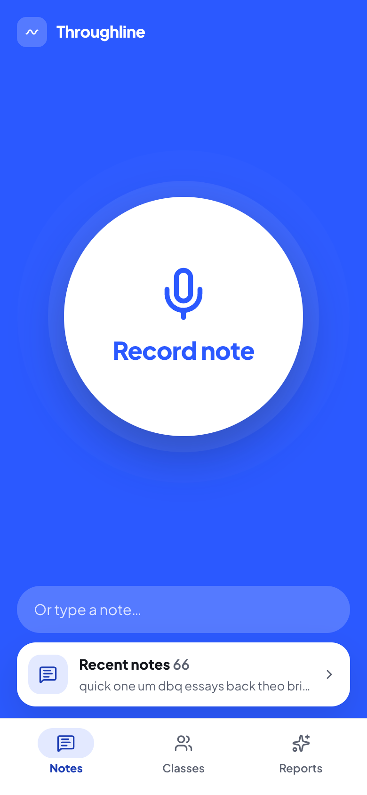
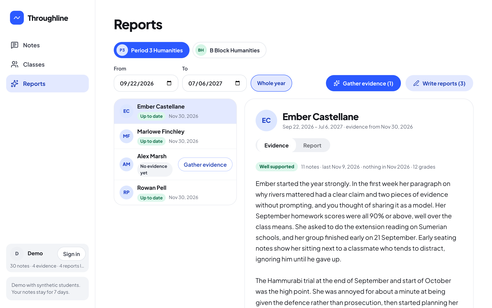

# Throughline

A teacher speaks or types quick notes about their students. Throughline tags each note to the students it mentions, then writes a cited summary of each student and a draft report for parents from that evidence.

**Try it:** https://throughline.drewmathieson.com ("Try the demo" needs no account; the students are synthetic.)

<p>
  
  
</p>

## How it works

- **Notes:** voice notes are transcribed by Whisper on Workers AI; the audio is never stored.
- **Tagging:** Claude Haiku 5.5 matches each note to students, keeping the verbatim quotes as evidence.
- **Evidence and reports:** Claude Opus 5.5 writes each student's summary from their notes and grades, then a parent-facing report the teacher can edit.
- **Guardrails:** Google sign-in with per-teacher data, an allowlist, a per-account AI spend cap, hard deletes, a JSON export and a [privacy page](https://throughline.drewmathieson.com/privacy).

## Stack

React 19, Vite and Tailwind on the front; one Cloudflare Worker (Hono) with D1 through Drizzle on the back. It installs to a phone's home screen and takes notes offline.

The reasoning behind each choice is in [DECISIONS.md](DECISIONS.md).

## Run it

```
cp .dev.vars.example .dev.vars   # fill in the keys
npm install
npm run db:migrate:local
npm run dev
npm run test
```

## Deploy

`npm run deploy` serves the app at https://throughline.drewmathieson.com (the workers.dev address keeps working).
The Google OAuth client must list `https://throughline.drewmathieson.com/api/auth/callback` as an authorised redirect URI.

## Who can sign in

Sign-in is open to any Google account unless `ALLOWED_EMAILS` is set: a comma-separated list of Google emails, `npx wrangler secret put ALLOWED_EMAILS` in production and `ALLOWED_EMAILS=` in `.dev.vars` locally. Accounts on `OWNER_EMAILS` are always allowed. Someone taken off the list is stopped at their next sign-in; a session they already hold runs on.

## License

[MIT](LICENSE)
